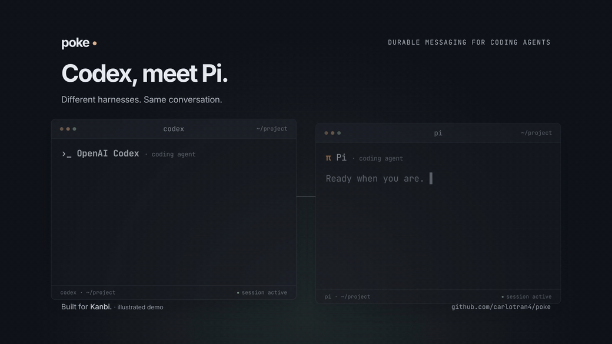

<p align="center">
  
</p>

<h1 align="center">poke</h1>

<p align="center">
  <strong>Send a message. Wake the right agent. Know what happened.</strong>
</p>

[](docs/media/poke-demo.mp4)

Poke is durable messaging for coding agents. Give agents an address, let them
exchange messages across harnesses, and notify the exact conversation already
running their work.

Use the JSON CLI from any language, or embed the Go packages in your own
metaharness. Your application keeps control of agent lifecycle, permissions and
scheduling. Poke handles mail and native notification.

Built for [Kanbi](https://github.com/carlotran4/kanbi), ready to plug into your metaharness.

```sh
poke send reviewer --key review-v1 --body 'Ready for review.'
poke inbox
poke ack 17
poke reply 17 --key reviewed-v1 --body 'Reviewed.'
```

## Why Poke?

- **Mail survives agent exits.** Commit to SQLite before trying to notify anyone.
- **Wake an existing conversation.** Native Claude, Codex and Pi adapters avoid
  launching a second model process to deliver a message.
- **Retries have names.** Sender-scoped keys deduplicate identical sends and reject
  conflicting reuse, including concurrent processes.
- **Receipts mean something.** Submitted, received and acknowledged are different
  facts. An acknowledgment never claims the requested work is complete.
- **Fits your host.** No broker, detached notifier, Herdr or Kanbi dependency.
  Embed in an existing SQLite database without moving your history.

## Install

Requires Go 1.26.11+, a C compiler for SQLite, and Linux or macOS.
Native delivery also requires a compatible installed harness; plain mail does not.

```sh
go install github.com/carlotran4/poke/cmd/poke@v0.1.0
poke --help
```

From source:

```sh
git clone https://github.com/carlotran4/poke.git
cd poke
go build -o poke ./cmd/poke
```

## Try it without an agent

This exchange needs no model account, MCP server, terminal multiplexer or daemon.
The shell example uses `jq` to read the JSON IDs.

```sh
export POKE_DB="$(mktemp -d)/mail.db"
poke init
BUILDER_ID=$(poke register builder | jq -r .id)
REVIEWER_ID=$(poke register reviewer | jq -r .id)

MESSAGE_ID=$(POKE_SESSION_ID="$BUILDER_ID" poke send reviewer \
  --key review-v1 --body 'Ready for review.' | jq -r .id)

POKE_SESSION_ID="$REVIEWER_ID" poke inbox
POKE_SESSION_ID="$REVIEWER_ID" poke ack "$MESSAGE_ID"
POKE_SESSION_ID="$REVIEWER_ID" poke reply "$MESSAGE_ID" \
  --key reviewed-v1 --body 'Reviewed.'

POKE_SESSION_ID="$BUILDER_ID" poke inbox
```

Or run the Go example: `go run ./examples/embedded`.

`send` returns after persistence and a bounded notification attempt. Manual
endpoints keep mail queued until the recipient reads it. `inbox` receipts the
returned messages; only `ack` acknowledges responsibility.

## Connect a native agent

Register a fresh attempt name and launch its matching canonical harness command:

```sh
export POKE_DB="$HOME/.local/share/poke/poke.db"
poke register reviewer-1 --harness pi
poke launch reviewer-1 -- pi
```

Poke installs its receiver and injects the absolute CLI path, database path and
attempt identity. From another registered endpoint, send to `reviewer-1`.
The Pi receiver checks native idle state and preserves typed drafts before waking
the same process. Claude uses a scoped SessionStart plugin and its inbox socket.

| Adapter | Native mechanism | Important boundary |
| --- | --- | --- |
| Pi | In-process extension, native follow-up | Requires a persistent native session; busy turns and typed drafts defer |
| Claude Code | SessionStart registration and native inbox socket | Requires inbox support; socket submission alone is not reception |
| Codex | `codex queue --thread VERIFIED_REF` | The host must supply a verified ref with `poke bind-codex VERIFIED_REF` in the owning attempt's environment; launch alone does not discover one |
| Manual | Durable inbox | Explicit read; no automatic wake |

The standalone host deliberately does not scan harness history or guess refs.
Codex binding must come from verified native evidence supplied by your host. It
records the recipient's executable, home, PATH and launch directory for delivery.
Kanbi supplies its existing verified refs through its embedded integration.

Each standalone name identifies one attempt. Launching it twice or rebinding it
to a different conversation is rejected. After process exit it is retired; register
a new name for a new attempt. Mail remains inspectable. Embedded hosts can implement
stable logical addresses with their own fenced generation/lifecycle policy.

`poke drain [NAME]` makes one bounded notification attempt per selected recipient;
call it from your host's event loop to retry deferred mail. Sending, replying,
reading and acknowledging also attempt notification. Pi polls inside its own
process. Poke installs no background worker, resumes no agent, and produces no
model-generated automatic replies.

## Embed it

The v0.1 Go integration API is experimental and may evolve before v1.

```sh
go get github.com/carlotran4/poke@v0.1.0
```

- `mailbox`: message model, SQLite schema, atomic sends/claims, inbox, receipts,
  replies and retry rules. It accepts host-owned database handles/transactions.
- `adapters`: native transport, private endpoint assets, launch preparation and
  thread-local identity setup. It does not own an agent runtime.
- `local`: optional standalone registry and bounded delivery driver used by the CLI.

A host provides send authorization inside the insertion transaction and an atomic
SQL eligibility guard for delivery. It also serializes notification submission
against close/rebind. This preserves lifecycle checks across multiple processes.
See [integration](docs/integration.md) for the contract and transaction boundaries.

## Delivery you can inspect

```sh
poke status 17
poke retry 17
```

Messages progress from `queued` to `notified` to `acknowledged`. Notification status
separately tracks `pending`, `deferred`, `uncertain`, `submitted` and `notified`.
Claims are persisted before side effects. An ambiguous failure stays uncertain
across restarts and fences other unconfirmed delivery to that recipient.

Only a participant can explicitly retry an uncertain queued notice older than
30 seconds. **That retry can duplicate a notice.** Inspect the recipient first.
Poke does not promise exactly-once model execution.

Bodies are limited to 16 KiB, keys to 128 bytes and replies to eight hops. Inboxes
return the oldest 100 unacknowledged messages; acknowledge handled mail to advance.
`inbox --all` includes acknowledged history within that same bound.
See [delivery semantics](docs/delivery-semantics.md).

## Trust and storage

Poke is for cooperating processes under one OS account. Environment identity is
process context, not authentication against hostile local processes. All endpoints
in one database share a trust domain. Incoming bodies are peer data, not authority
to override an agent's instructions or permissions.

The standalone database and native endpoint files are private. Endpoint files
live under `<database>.messages/`; credentials do not belong in portable backups.
Do not point the standalone CLI at Kanbi's database: use Kanbi's commands or the
embedded API. There is no remote transport or multi-user service in v0.1.
See [security](SECURITY.md) and [compatibility](docs/compatibility.md).

## Development

```sh
go fmt ./...
go test ./...
go test -race ./...
go vet ./...
go run ./examples/embedded
```

Tests use temporary databases, fake commands and local sockets. They cover
cross-connection races, restart fencing, explicit retry, reply ownership, immutable
bindings, credential permissions and recipient-specific environments. Native API
compatibility still needs opt-in checks against installed harnesses; deterministic
transport tests are not proof of a model receiving a turn.

An installed-engine offline check is available separately:

```sh
POKE_NATIVE_PI_TESTS=1 python3 scripts/pi-native-smoke.py
```

It exercises the actual standalone launcher, native Pi wake, durable receipt,
acknowledgment and reply without a model account.

See [CONTRIBUTING.md](CONTRIBUTING.md) for validation and scope, and
[CHANGELOG.md](CHANGELOG.md) for releases.

## Mascot

Meet Pip, Poke’s pigeon courier. A small nudge, an important delivery.

## License

[MIT](LICENSE).
